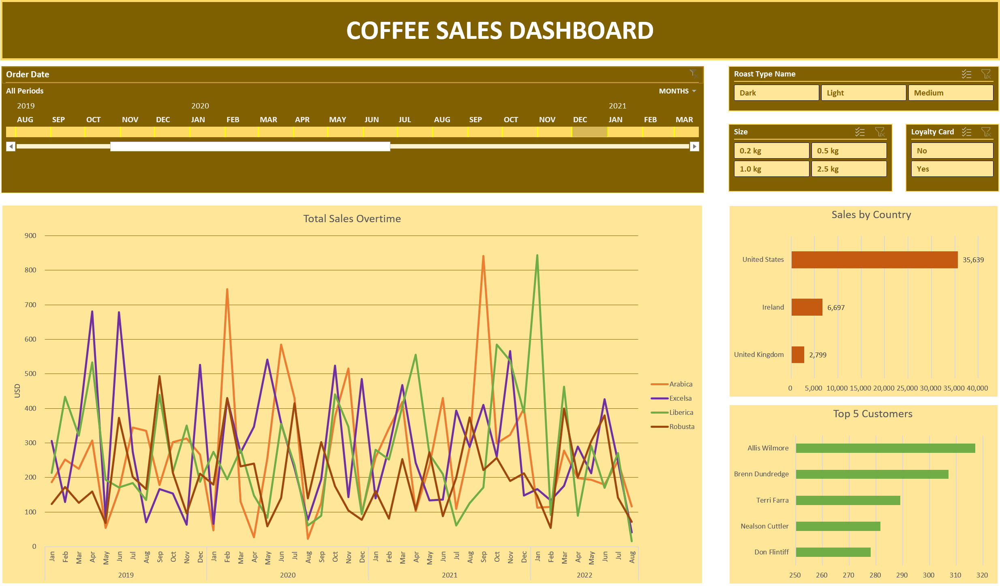

# Coffee Sales Analysis 2019–2022: Excel Dashboard for Product, Country, and Customer Performance

Sales analysis of coffee orders from January 2019 to August 2022, built in Microsoft Excel. The project covers a three-table data model, formula-driven sales calculations, PivotTables, and an interactive dashboard with Slicers and a Timeline.

## Project Overview

| Metric | Value |
|---|---|
| **Data period** | January 2, 2019 – August 19, 2022 |
| **Order lines** | 1,000 (957 unique Order IDs) |
| **Customers with orders** | 913 of 1,000 registered customers |
| **Products** | 48 SKUs (4 coffee types × 3 roast types × 4 sizes) |

## Business Questions

- How do sales trend month over month and year over year?
- Which coffee types, roast types, and package sizes drive the most revenue?
- Which countries are the main markets?
- Who are the top customers, and do loyalty card holders spend more?

## Dataset

The workbook `coffeeOrdersData.xlsx` contains 7 sheets.

| Sheet | Content |
|---|---|
| **Dashboard** | Three charts, three Slicers, and one Timeline |
| **TotalSales** | PivotTable of sales by year and month, split by coffee type |
| **CountryBarChart** | PivotTable of sales by country |
| **Top5Customers** | PivotTable of the five customers with the highest sales |
| **orders** | `Orders` table: 1,000 rows, 16 columns |
| **customers** | 1,000 customers: ID, name, email, phone, address, city, country, postcode, loyalty card status |
| **products** | 48 products: Product ID, coffee type, roast type, size, unit price, price per 100 g, profit |

## Excel Features Used

| Category | Features |
|---|---|
| **Formulas** | XLOOKUP, INDEX, MATCH, nested IF |
| **Data structure** | Excel Table (`Orders`) with structured references |
| **Analysis** | PivotTables, Top 5 filter |
| **Visualization** | PivotCharts (line and bar) |
| **Interactivity** | Slicers, Timeline |

## Key Findings

| Aspect | Finding |
|---|---|
| **Yearly trend** | Sales were $12,187.17 in 2019, dipped 0.6% to $12,117.55 in 2020, then rose 13.6% to $13,766.11 in 2021. 2022 data covers only January – August 19 ($7,063.44). |
| **Coffee type** | Excelsa (27.3%), Liberica (26.7%), and Arabica (26.1%) are close together. Robusta is the lowest at 20.0% ($9,005.25). |
| **Profit by coffee type** | Liberica generates the highest profit ($1,567.03; 13% margin), followed by Excelsa (11%) and Arabica (9%). Robusta is the lowest ($540.31; 6% margin). Total profit is $4,520.22 (10.0% margin). |
| **Package size** | The 2.5 kg size contributes **52.7%** of sales ($23,785.57) from only 23.7% of units sold. Unit volumes across sizes are fairly even (841–943). |
| **Roast type** | Light 38.5%, Medium 32.3%, Dark 29.2%. |
| **Country** | United States **79.0%** ($35,638.89), Ireland 14.8% ($6,696.87), United Kingdom 6.2% ($2,798.51). |
| **Customers** | The top 5 customers (highest: Allis Wilmore, $317.07) account for only 3.3% of total sales, so revenue does not depend on a few buyers. Only 25 of 913 customers (2.7%) placed more than one order. |
| **Loyalty card** | Card holders contribute 46.3% of sales, with an average of $43.67 per order line versus $46.48 for non-holders. |
| **Peak months** | February 2020 ($1,798.34), April 2019 ($1,680.75), and September 2021 ($1,643.58). |

## Recommendations

| Recommendation | Supporting data |
|---|---|
| Prioritize promotions and bundles for the 2.5 kg size | 52.7% of sales from 23.7% of units |
| Review Robusta pricing or strategy, and shift promotion toward Liberica and Excelsa | Robusta has the lowest sales and a 6% margin versus 13% for Liberica |
| Develop the Ireland and United Kingdom markets | Together they account for 21.0% of sales, versus 79.0% for the United States |
| Strengthen retention programs and evaluate the loyalty card benefits | Only 2.7% of customers reordered, and card holders do not spend more per order |

## Data Limitations

- 2022 data ends on August 19, 2022, so 2022 is not comparable with the full years.
- Email is empty for 204 customers and Phone Number is empty for 130 customers. This does not affect sales calculations.
- Profit is calculated from the `Profit` column in the `products` sheet multiplied by Quantity. Operating costs are not available, so the analysis focuses on revenue and per-product profit.

## Contact

**Syasya Tri Puspita Dewi**
Portfolio: [syasyatpd.github.io](https://syasyatpd.github.io)
